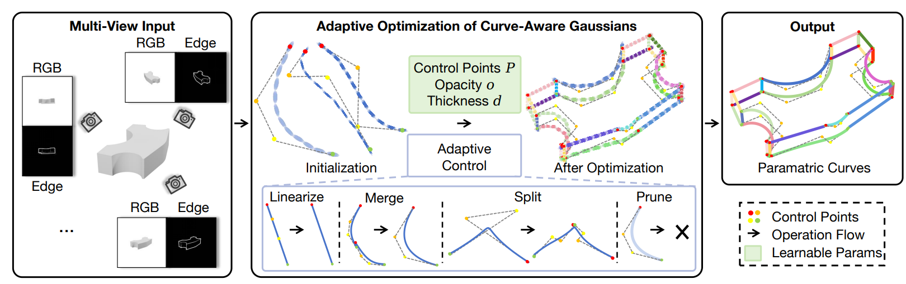
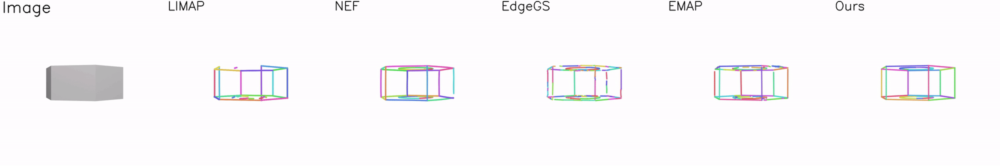
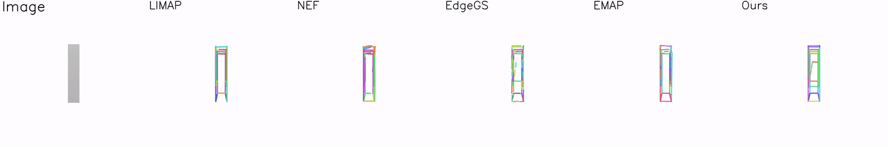
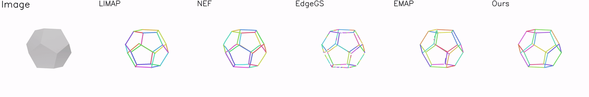

# [ICCV 2025] CurveGaussian

<h2 align="center">

Gaussian Splatting Consciente de Curvas para la Reconstrucción de Curvas Paramétricas 3D

[Zhirui Gao](https://scholar.google.com/citations?user=IqtwGzYAAAAJ&hl=zh-CN), [Renjiao Yi](https://renjiaoyi.github.io/), Yaqiao Dai, Xuening Zhu, [Wei Chen](https://openreview.net/profile?id=~Wei_Chen35),  [Chenyang Zhu](https://www.zhuchenyang.net/), [Kai Xu](https://kevinkaixu.net/)

[](https://arxiv.org/abs/2506.21401)
[](https://zhirui-gao.github.io/CurveGaussian/)
[](https://zhirui-gao.github.io/CurveGaussian/)

<p>
    
</p>

<p align="center">
<span style="font-size: 16px">
CurveGaussian permite una reconstrucción compacta de curvas paramétricas 3D a partir de mapas de bordes 2D multivista.  
</span>
</p>


<p>
    
</p>

</h4>

Este repositorio contiene la implementación oficial del artículo: [Gaussian Splatting Consciente de Curvas para la Reconstrucción de Curvas Paramétricas 3D](https://arxiv.org/abs/2506.21401), aceptado en ICCV 2025.
CurveGaussian es un nuevo marco de acoplamiento bidireccional entre curvas paramétricas y componentes gaussianos orientados a bordes, que permite la optimización directa de curvas paramétricas a través de Gaussian Splatting diferenciable.

Si encuentras este repositorio útil para tu investigación o trabajo, agradecemos mucho que marques este repositorio con una estrella ✨ y cites nuestro artículo 📚.

No dudes en contactarme (gzrer2018@gmail.com) o abrir un issue si tienes alguna pregunta o sugerencia.


## 🔥 Ver también

También puedes estar interesado en otros de nuestros trabajos:
- [**[ICCV 2025] PartGS**](https://github.com/zhirui-gao/PartGS): Un marco de reconstrucción auto-supervisado consciente de las partes que integra 2D Gaussians y superelipsoides para analizar objetos y escenas en una descomposición interpretable.

- [**[TCSVT 2025] PoseProbe**](https://github.com/zhirui-gao/PoseProbe): Un enfoque novedoso que utiliza objetos cotidianos comunes tanto en imágenes como en la vida real como sondas de pose, para abordar la reconstrucción de NeRF con pocas vistas utilizando solo 3 a 6 imágenes de escena sin pose.


- [**[CVMJ 2024] DeepTm**](https://github.com/zhirui-gao/Deep-Template-Matching): Un método preciso de coincidencia de plantillas basado en un refinamiento diferenciable de correspondencias de «lo grueso a lo fino», diseñado especialmente para piezas industriales planas.


## 📢 Noticias
- **27-06-2025**: El artículo está disponible en arXiv.
- **26-06-2025**: CurveGaussian ha sido aceptado en ICCV 2025. 🎉


## 📋 TAREAS PENDIENTES

- [x] Liberación del código de entrenamiento y evaluación.
- [x] Código de evaluación y visualización.
- [ ] Soporte para conjuntos de datos personalizados.


## 🔧 Instalación

```
git clone --recurse-submodules https://github.com/zhirui-gao/Curve-Gaussian.git
```
El entorno de nuestro código es similar al de 3DGS.

Hemos desarrollado una biblioteca de rasterización personalizada (`diff-cur-rasterization`) basada en la implementación original de [diff-gaussian-rasterization](https://github.com/graphdeco-inria/gaussian-splatting).

Si ya tienes un entorno para 3DGS, solo ejecuta:
```
pip install  submodules/diff-cur-rasterization
```
De lo contrario, deberías crear un nuevo entorno de conda:

```
conda env create --file environment.yml
conda activate gaussian_splatting
```


## 📊 Conjunto de Datos

Para el conjunto de datos ABC, utilizamos el proporcionado por [EMAP](https://drive.google.com/file/d/17aUcCJCP5vgARs237H0BtlRoms5-CR6e/view).  

Para el conjunto de datos Replica, descárgalo desde [enlace](https://drive.google.com/file/d/1ZG2gdZpcNZovgw8oKZTPT9lHqII3LWyG/view?usp=sharing)

Descargar conjuntos de datos:
```
python scripts/download_data.py 
```


Los datos están organizados de la siguiente manera:
```
<scan_id>
|-- meta_data.json      # parámetros de cámara
|-- color               # imágenes de cada vista
    |-- 0_colors.png
    |-- 1_colors.png
    ...
|-- edge_DexiNed        # mapas de bordes extraídos con DexiNed
    |-- 0_colors.png
    |-- 1_colors.png
    ...
|-- edge_PidiNet        # mapas de bordes extraídos con PidiNet
    |-- 0_colors.png
    |-- 1_colors.png
    ...
```

## 🚀 Entrenamiento 

### ABC-dataset

Ejecutar un solo conjunto de datos:

```
python train.py -s /media/gzr/ABC-NEF_Edge/data/00000168 -m output/00000168  -r 2 --eval  --quiet
```

Ejecutar el conjunto de datos completo:

```
python scripts/run_batch_ABC.py
```

### Replicat-dataset

Editar `arguments/__init__.py`:
```
self.detector = 'PidiNet'  
```

```
bash scripts/run_replica.sh
```


## 👊 Evaluación

### ABC-dataset
```
python edge_extraction/eval_ABC.py
```

Si deseas renderizar un video continuo de curvas paramétricas:

Primero descarga los [archivos de poses de cámara](https://drive.google.com/file/d/1izmZaDlJc_JDkndBTYqCpjYlwReEEilw/view?usp=sharing) para la proyección y organiza el conjunto de datos de la siguiente manera:

```
<scan_id>
|-- meta_data.json      # parámetros de cámara
|-- transforms_video.json   # parámetros de cámara continuos
|-- video  # imágenes gt bajo parámetros de cámara continuos
```

Luego, simplemente ejecuta el comando:
```
python edge_extraction/eval_ABC.py --render_mv True
```

### Replica-dataset

```
python edge_extraction/eval_replica.py
```
Esto es solo para calcular el número de curvas y realizar visualizaciones, ya que no se disponen de las curvas de Ground Truth (GT).


## 👀 Resultados Visuales


### ABC-NEF Dataset
<p align="center">
    
    
    

</p>

### Replica Dataset 

<p align="center">
    
    
</p>


## 📚 Cita
Si nuestro trabajo te ha sido útil, considera citarnos:
```bibtex
@misc{gao2025curveawaregaussiansplatting3d,
      title={Curve-Aware Gaussian Splatting for 3D Parametric Curve Reconstruction}, 
      author={Zhirui Gao and Renjiao Yi and Yaqiao Dai and Xuening Zhu and Wei Chen and Chenyang Zhu and Kai Xu},
      year={2025},
      eprint={2506.21401},
      archivePrefix={arXiv},
      primaryClass={cs.CV},
      url={https://arxiv.org/abs/2506.21401}, 
}
```

<!-- ## Contact
If you encounter any issues, you can also contact Gao through gzrer2018@gmail.com. -->


## Agradecimientos
Este proyecto se basa en [3DGS](https://github.com/graphdeco-inria/gaussian-splatting), [EMAP](https://github.com/cvg/EMAP) y [NEF](https://github.com/yunfan1202/NEF_code). Utilizamos las versionesredes preentrenadas de [DexiNed](https://github.com/xavysp/DexiNed) y [PidiNet](https://github.com/hellozhuo/pidinet) para la extracción de mapas de bordes. Agradecemos a todos los autores por su excelente trabajo y repositorios.
